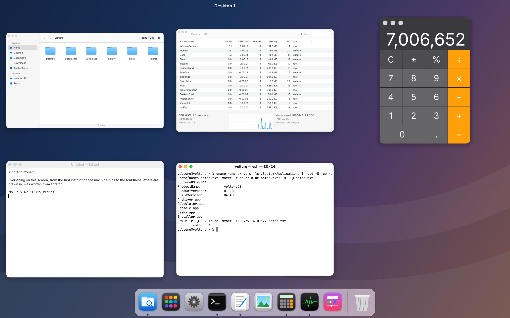
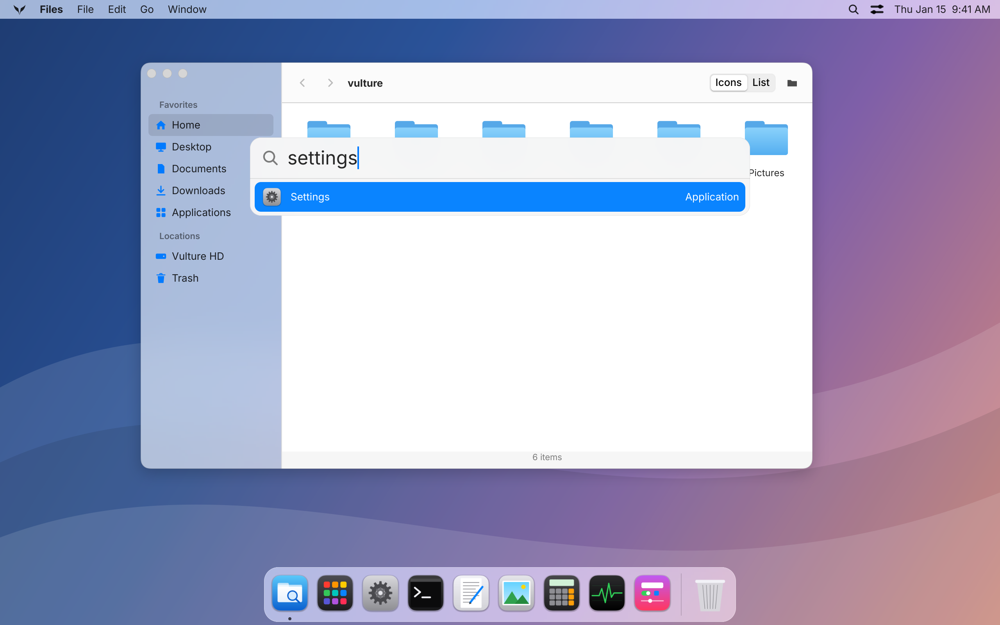
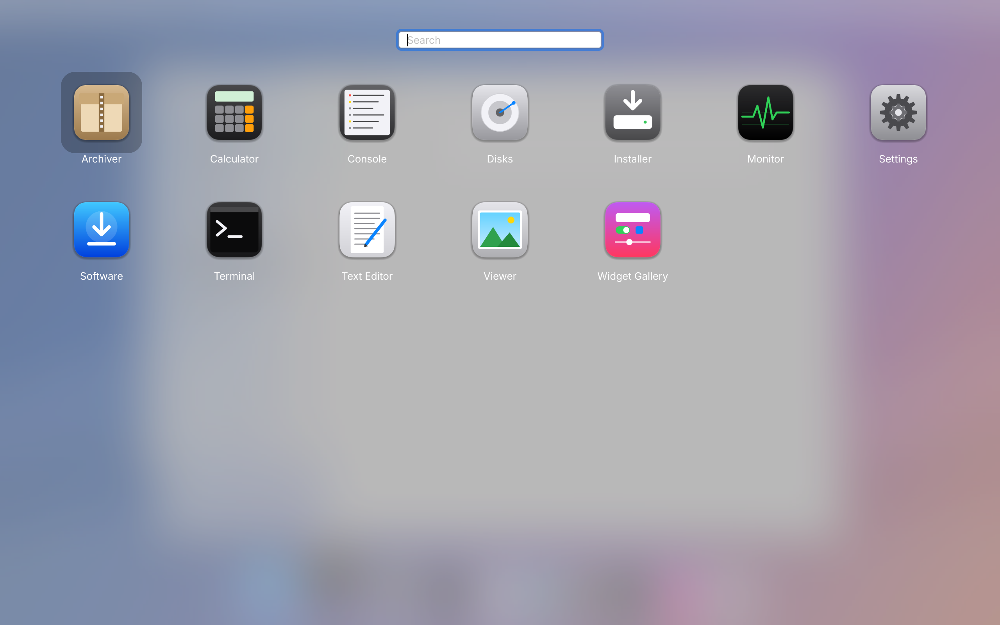
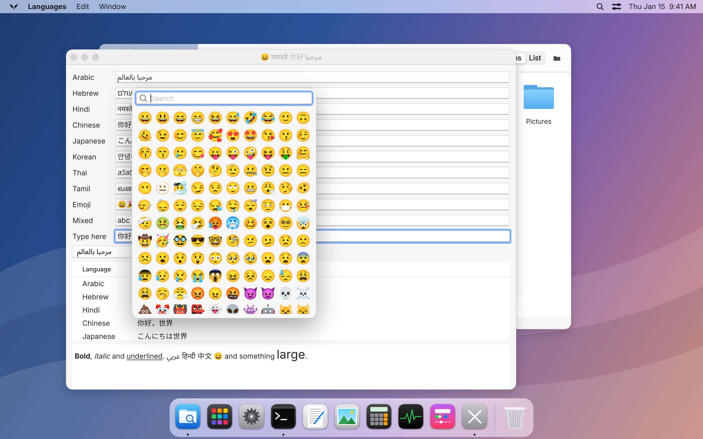
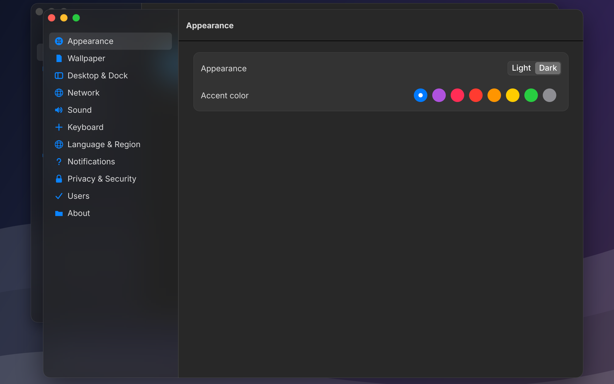
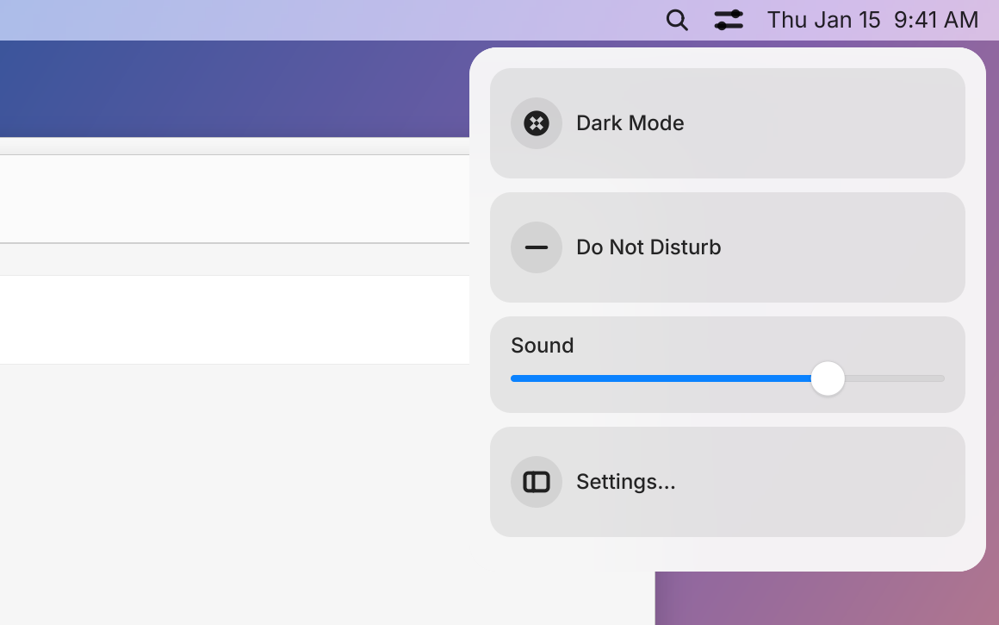
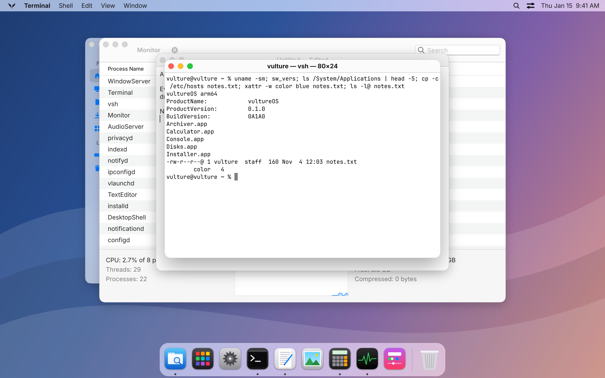
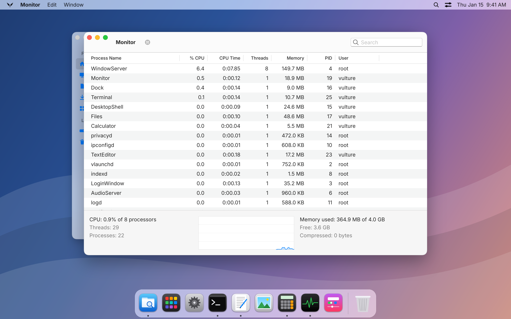

<div align="center">


# vultureOS

### A whole operating system, written from the first instruction up.

It looks and feels like a Mac, and it doesn't share a line of code with one.<br>
Not Linux with a nice theme: its own kernel, filesystem, window server, font engine and apps.<br>
Every line of it is right here in this repository.

**[Try it](#try-it)** &nbsp;·&nbsp; [What's inside](#whats-inside) &nbsp;·&nbsp; [How close is it?](#how-close-is-it) &nbsp;·&nbsp; [Roadmap](Documentation/Roadmap.md)

<br>



<sub>A real screenshot, not a mock-up. Five apps open in Overview, at 2560 × 1600.</sub>

</div>

<br>

## You already know how to use it

Sit down at vultureOS and your hands know what to do. The menu bar is at the top, the Dock is at the bottom, and windows have traffic lights. Command-Space finds things. Control-Up spreads your windows out. Drag a window to the side of the screen and it takes half; rest on the green button for the rest. Shift-Command-4 takes a picture of part of the screen. Press and hold a key for its accents.

It comes with what you'd reach for first: Files, Settings, Terminal, Text Editor, Viewer, Calculator, Monitor, Console, Disks, Archiver and Software. Log in as `vulture`, password `vulture`.

<table>
  <tr>
    <td width="50%" align="center" valign="top">
      <br>
      <sub><b>Search</b> finds apps and files as you type.</sub>
    </td>
    <td width="50%" align="center" valign="top">
      <br>
      <sub><b>Launcher</b> has every app, over a blurred desktop.</sub>
    </td>
  </tr>
</table>

<br>

## Not just for English

Arabic joins up and runs right to left. Hindi forms its conjuncts. Chinese, Japanese, Korean, Thai and Tamil all just work, in every text field, menu and title bar, with emoji in colour.

That's our own shaping engine, and it doesn't get to mark its own homework. **135 lines of text in ten scripts go through it and through a real Mac's Core Text, and they come out the same: the same glyphs, in the same places.**

Typing works too, with Pinyin, Kana and Hangul input, dead keys, an emoji picker, spell check and autocorrect.

<p align="center">
  
</p>

<br>

## Sweats the small stuff

"Looks about right" isn't the standard here. Control sizes, insets and colours are measured from AppKit itself, and the screens are compared against reference pictures on every test run. A difference no bigger than a small dot fails the tests.

Nothing of Apple's is in here. Every icon, wallpaper, symbol and sound is original.

<table>
  <tr>
    <td width="50%" align="center" valign="top">
      <br>
      <sub><b>Dark mode</b> and eight accent colours, all the way down.</sub>
    </td>
    <td width="50%" align="center" valign="top">
      <br>
      <sub><b>Quick Settings</b>, one click away in the menu bar.</sub>
    </td>
  </tr>
</table>

<br>

## We cut the power 100 times. Nothing was lost.

The test is simple and brutal. The machine writes files, the power is cut at a random moment, and a checker goes over the whole disk. We do that 100 times in a row, and everything that was committed has to still be there. It is.

That's **vultureFS**, our own filesystem, and it does more than survive:

<table>
  <tr>
    <td width="33%" valign="top"><b>Instant copies</b><br><sub>A 1 GiB file clones in under a millisecond, and takes no extra room until one of them changes.</sub></td>
    <td width="33%" valign="top"><b>Snapshots</b><br><sub>Go back to any moment you saved, exactly as it was.</sub></td>
    <td width="33%" valign="top"><b>A disk that tells you</b><br><sub>Every block has a checksum. If one bit goes bad, you get an error, not wrong data.</sub></td>
  </tr>
  <tr>
    <td valign="top"><b>A sealed system</b><br><sub>The system is signed, block by block. Flip one bit and that file stops working. Tamper with the signature and it won't boot.</sub></td>
    <td valign="top"><b>Names that behave</b><br><sub><code>café</code> is <code>café</code> however it was typed, and <code>README</code> is <code>readme</code>, exactly as on a Mac.</sub></td>
    <td valign="top"><b>Room to grow</b><br><sub>Compression, extended attributes, access control lists, and a format built for up to 8 PiB.</sub></td>
  </tr>
</table>

<br>

## Under the desktop, a real Unix

Open Terminal and it's all there: a shell with job control, more than 120 commands in the places you'd expect them, processes, threads, pipes, sockets and signals. `dlopen`, `kqueue` and `ptrace` too. There's TCP/IP, TLS 1.3 and `curl`.

**All 1,012 of our system checks pass**, covering POSIX and the things a Mac adds to it. The same checks also run on a real Mac, and every place the two differ is written down, with the reason why.

<table>
  <tr>
    <td width="50%" align="center" valign="top">
      <br>
      <sub><b>Terminal</b>, with a clone and an extended attribute.</sub>
    </td>
    <td width="50%" align="center" valign="top">
      <br>
      <sub><b>Monitor</b>: 22 processes, and 365 MB of memory in use.</sub>
    </td>
  </tr>
</table>

<br>

## Measured, not claimed

These come from a running system, on QEMU with hardware virtualization on Apple Silicon. The last two aren't there yet, and they're in the table anyway, because that's the point of having a table. [A new compositor](Documentation/Roadmap.md#m21-layers) is coming for them.

<div align="center">

| What | Measured | Goal |
|:---|---:|---:|
| Boot, from firmware handoff to login window | **0.22 s** | 2 s |
| App launch, cold | **24 ms** | 300 ms |
| Clone a 1 GiB file | **under 1 ms** | 50 ms |
| System call | **72 ns** | 150 ns |
| Dragging a window at 2560 × 1600 | 59.1 fps | 60 fps |
| Input to screen update, 99th percentile | 23.5 ms | 16.7 ms |

</div>

<br>

## What's inside

Everything from the first instruction after the firmware to the last pixel on screen is ours. There are no external libraries. All we didn't write is data: the fonts (Inter and Noto, both openly licensed), Unicode's and CLDR's tables, a word list, and root certificates.

<div align="center">

| Part | What it is | Lines |
|:---|:---|---:|
| **VultureBoot** | UEFI loader for AArch64 and x86_64, plus a Raspberry Pi start-up stub | 3,000 |
| **Kernel** | Every processor, QoS scheduling, memory compression, sandboxes, TCP/IP, drivers from NVMe to USB | 47,000 |
| **Libraries** | C library, pranaUI toolkit, graphics, Unicode, text shaping, TLS, vultureFS | 75,000 |
| **Services** | PranaWindowServer, launchd, Dock, Files, login window, notifications, indexing | 13,000 |
| **Commands** | The shell and more than 120 commands | 25,000 |
| **Applications** | Settings, Text Editor, Monitor and the rest | 7,000 |
| **Tests** | Unit tests, whole-system walkthroughs, attacks on the kernel, comparisons with a Mac | 31,000 |

</div>

It's all C++23, and it takes security seriously: W^X, ASLR, KASLR, pointer authentication, signed programs, sandboxes and privacy prompts.

<br>

## How close is it?

We keep a [scoreboard](Documentation/Parity.md). It lists what macOS does, feature by feature, and it's generated from test results, so nothing counts until a test proves it.

<p align="center">
  
</p>

<div align="center">

<table>
  <tr>
    <th width="50%" align="left">You can do this today</th>
    <th width="50%" align="left">You can't yet</th>
  </tr>
  <tr>
    <td valign="top">
      Log in, use windows, the Dock and Overview<br>
      Manage files, and search them<br>
      Type Arabic, Hindi, Chinese and more<br>
      Use the terminal, and install signed packages<br>
      Reach the network, over TLS 1.3<br>
      Boot ARM and x86 from a single disk<br>
      Plug in a USB stick, and erase or repair it<br>
      Keep moving when an app stops answering<br>
      Use two displays, and swipe between Spaces<br>
      Tile windows, go full screen, or work in Stage<br>
      Take screenshots, answer notifications, and put widgets on the desktop
    </td>
    <td valign="top">
      Browse the web<br>
      Read a PDF<br>
      Use mail, music or video<br>
      Run real Mac apps, which isn't the goal<br>
      Trust it on real hardware: it's only run in QEMU
    </td>
  </tr>
</table>

</div>

So please don't move your life onto it just yet. **You're early, and this is the fun part.** The [roadmap](Documentation/Roadmap.md) goes from here to a browser engine, Mail, Music, a developer IDE, and building vultureOS on vultureOS.

<br>

## Try it

On a Mac with Apple Silicon, this is all it takes:

```sh
git clone https://github.com/vultureOS/vulture.git && cd vulture
brew install llvm@22 lld@22 cmake ninja qemu
Meta/build.sh && Meta/run.sh
```

A window opens. Log in as **`vulture`**, password **`vulture`**. Your files stay on a disk image that survives rebuilds.

Want other languages and emoji? Run `Meta/fetch-fonts.sh` before you build. Those fonts are a download of their own, and without them you get boxes where those letters would be.

<details>
<summary><b>On Linux</b></summary>

<br>

Ubuntu 24.04 is tested. QEMU uses KVM on an AArch64 machine and emulates elsewhere, which is several times slower. Add LLVM 22 from [apt.llvm.org](https://apt.llvm.org), then:

```sh
git clone https://github.com/vultureOS/vulture.git && cd vulture
sudo apt install clang-22 lld-22 llvm-22 libclang-rt-22-dev cmake ninja-build \
    qemu-system-arm qemu-efi-aarch64
Meta/build.sh && Meta/run.sh
```

</details>

<details>
<summary><b>More ways to run it</b></summary>

<br>

| Command | What it does |
|:---|:---|
| `Meta/run_debug.sh` | The same desktop, with the kernel's log, every process and every service in your terminal |
| `Meta/run_console.sh` | Boots to the text console instead |
| `Meta/run.sh --fresh-disk` | Starts over with a new disk |
| `Meta/run.sh --real-devices` | Uses what real machines have instead of virtio: AHCI, xHCI, e1000e, HD Audio |
| `Meta/run.sh --raspberry-pi` | Boots on QEMU's Raspberry Pi 4 |
| `Meta/run.sh --help` | Everything else |

For x86_64:

```sh
Meta/build.sh --build-dir build-x86_64 --arch x86_64
Meta/run.sh --build-dir build-x86_64
```

</details>

<details>
<summary><b>Running the tests</b></summary>

<br>

```sh
Meta/build.sh --check
```

That runs the unit tests, the kernel's own tests, 50 programs inside the system, the comparisons with your Mac, golden screenshots of everything on screen, deliberate attacks on the kernel, a sanitized kernel, and every driver on QEMU's models of real devices. Then there's the Monday test, which works through an ordinary day with a real keyboard and pointer.

`ninja -C build test-crash` runs the 100 power cuts, and `ninja -C build parity` regenerates the scoreboard.

</details>

<details>
<summary><b>Making a bootable disk</b></summary>

<br>

```sh
ninja -C build image
Meta/run.sh --image build/vultureOS.img
```

That's one bootable disk, laid out as a real machine has it: an EFI System Partition, the signed system, and a data volume. For a Raspberry Pi, see [its guide](Documentation/RaspberryPi.md).

</details>

<br>

## Got a spare machine?

This is the most useful thing you could offer. vultureOS has never run on real hardware, and QEMU's devices aren't the real ones, so something will go wrong, and we'd love to know what.

[Make a bootable disk](#try-it) and start from it. Even with no serial port, it keeps what happened in `Logs/boot.txt` and `Logs/panic.txt` on the EFI partition. **[Send those to krishpranav](https://github.com/krishpranav)**: a report from a real machine goes straight to the front of the queue.

<br>

## Read more

<div align="center">

<table>
  <tr>
    <td><a href="Documentation/Roadmap.md">Roadmap</a></td>
    <td>What comes next, every milestone, and what each one found</td>
  </tr>
  <tr>
    <td><a href="Documentation/Parity.md">Parity</a></td>
    <td>How close to macOS this is, feature by feature</td>
  </tr>
  <tr>
    <td><a href="Documentation/Architecture.md">Architecture</a></td>
    <td>Design, build system and how the repository is laid out</td>
  </tr>
  <tr>
    <td><a href="Documentation/VultureFS.md">vultureFS</a></td>
    <td>The filesystem, on disk and in the kernel</td>
  </tr>
  <tr>
    <td><a href="Documentation/DesignSystem.md">Design System</a></td>
    <td>How the look is measured and locked</td>
  </tr>
  <tr>
    <td><a href="Documentation/POSIX.md">POSIX</a></td>
    <td>What's checked, and how it compares with a Mac</td>
  </tr>
  <tr>
    <td><a href="Documentation/Syscalls.md">System Calls</a> &nbsp;·&nbsp; <a href="Documentation/BootProtocol.md">Boot Protocol</a></td>
    <td>The details</td>
  </tr>
  <tr>
    <td><a href="Documentation/RaspberryPi.md">Raspberry Pi</a> &nbsp;·&nbsp; <a href="Documentation/CodingStyle.md">Coding Style</a> &nbsp;·&nbsp; <a href="Documentation/Naming.md">Naming</a></td>
    <td>The rest</td>
  </tr>
</table>

</div>

<br>

<div align="center">


Made by [krishpranav](https://github.com/krishpranav). Licensed under the [GPL-3.0](LICENSE). The earlier Rust version is kept at tag `v0.1-rust`.

<sub>vultureOS is an independent project. It isn't affiliated with or endorsed by Apple Inc. macOS and Mac are trademarks of Apple Inc.</sub>

</div>
